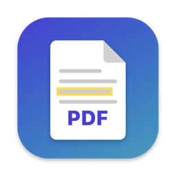
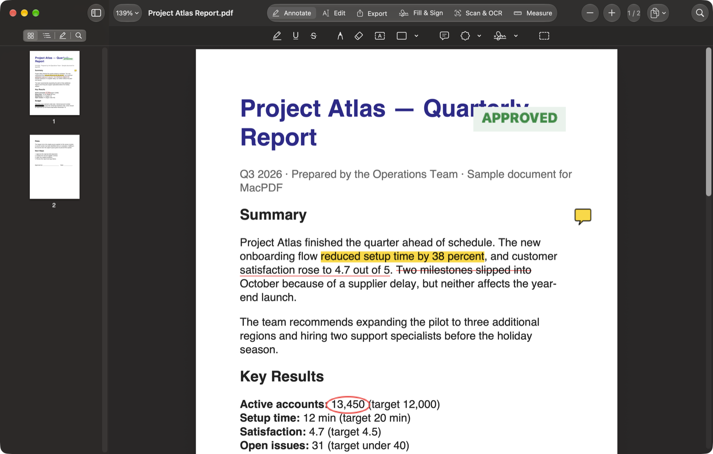
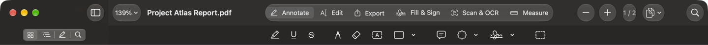
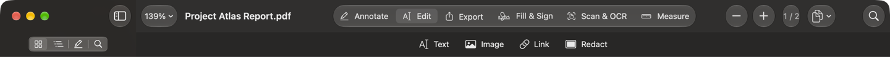
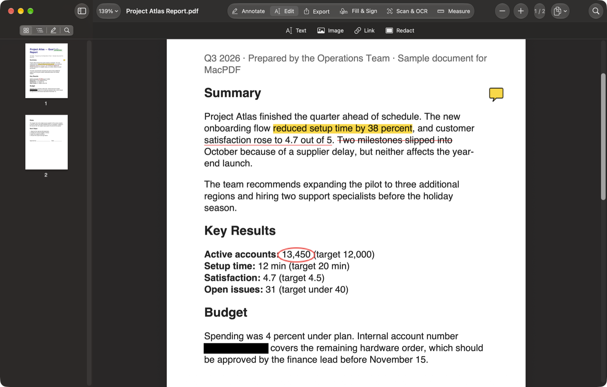
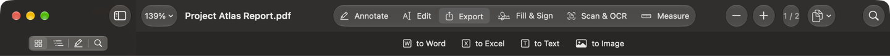
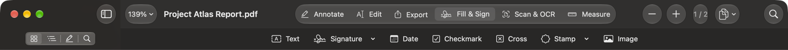
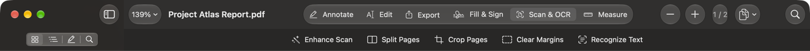
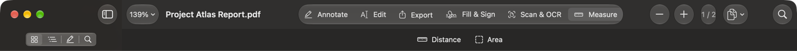

<p align="center">
  
</p>

<h1 align="center">MacPDF</h1>

<p align="center">
  A fast, native PDF editor for macOS. Annotate, edit, redact, sign, scan and export — built on Apple's PDFKit and Vision, with PDFium for rewriting page content.
</p>

<p align="center">
  
</p>

## Features

MacPDF organizes its tools into six modes, switchable from the tabs at the top of the window (or <kbd>⌘</kbd><kbd>⌃</kbd><kbd>1</kbd>–<kbd>6</kbd>).

### Annotate


Highlight, underline and strikethrough (select text to apply) · pen · eraser · text boxes · shapes (rectangle, oval, line, arrow) · comments · stamps (Approved, Draft, Confidential, …) · your saved signature · copy any area as an image. Every tool remembers its own color.

### Edit


- **Text** — click any paragraph and edit it like a word processor: the text reflows as you type, in the original font, size and color. The words are rewritten in the PDF itself, not layered on top.
  - **Style words or whole paragraphs** — select words and use bold, italic, size or color on just them; with nothing selected, the change applies to the paragraph. Font and alignment apply to the paragraph.
  - **Match the page** — the font menu lists the font and size combinations already used on the page, so edited text can match its neighbors in one click.
  - **Move and resize** — drag a paragraph to move it, or use the open box's move handle and border; the side handles change its width and the text rewraps.
  - **Alignment guides** — text and pictures snap to the edges and centers of other text, images and the page, with pink guide lines.
  - **Push text below** (on by default, ⤓ button) — when a paragraph gets longer or shorter, everything below it moves by the same amount, so the spacing stays the same. Whole rows move together on single-column pages; on multi-column pages only that column moves. The footer area stays put.
  - Click empty space to add new text.
- **Image** — click a picture (with either the Text or Image tool) to select it, drag to move, drag a corner to resize, and rotate, replace, export or delete it. *Add Image…* places a new one.
- **Link** — drag a box and attach a web address.
- **Redact** — select text or drag a box; it turns into a solid block in the color you pick, and the content underneath is **permanently removed** from the file. *Find & Redact…* removes every match of a word or number at once.
- **Header & Footer** — add text and page numbers (“Page {page} of {pages}”) to every page.
- **Patient Info…** — scans every page on this Mac for names, dates of birth and other dates, medical record and account numbers, Social Security numbers, phone and fax numbers, emails and addresses. You review them in a checklist, grouped by type with page numbers, then redact the ones you choose in one step.

<p align="center">
  
</p>

### Export


Word (.docx, text with fonts and styles) · Excel (.csv, split into columns where the PDF has gaps) · plain text · one PNG image per page.

**Compare…** opens an older version of the document and shows what changed: added text is highlighted in green on the page, and a sidebar list shows every addition and removal by page.

**Clean Copy…** saves a copy that's safe to share, without what people can't see on the page: document properties (author, title, software, dates), embedded XMP metadata, comments and markup, attached files, and optionally links. It tells you what it removed; your open document isn't changed.

### Fill & Sign


Text · signature (draw once, reuse) · today's date · checkmark · cross · stamps · images. Fillable PDF form fields work too — click and type.

**Auto-Fill** fills a form from **My Profile** — name, credentials, specialty, NPI, DEA, license number and state, phone, fax, email, address, practice, date of birth and today's date — saved only on this Mac. It works on fillable PDFs (matching field names), flat forms (finding labels like “Physician Name:”, “NPI # ____” or “City ___ State ___ Zip ___” and writing on the blank) and scanned forms (reading the labels with OCR first). Patient fields and anything already filled in are skipped, and every value is shown for review before filling.

### Scan & OCR


- **Enhance Scan** — cleans up the background and sharpens text.
- **Split Pages** — cuts two-page book scans into separate pages.
- **Crop Pages** — drag a box around what to keep, on one page or all.
- **Clear Margins** — whites out dark scan edges.
- **Recognize Text** — on-device OCR adds an invisible text layer so scans become searchable and selectable. The page looks exactly the same.

### Measure


Distance and area, labeled in inches and centimeters.

### AI assistant
A sidebar tab (✨) powered by Apple's on-device model — nothing is uploaded:
- **Ask a question** about the PDF. The most relevant passages are found with keyword and meaning search, and the answer is written only from them, with clickable page citations like **[p. 12]**.
- **Summarize** the current page, or the whole document section by section.

Requires macOS 26 or later with Apple Intelligence turned on.

### Also
- Tabs: each PDF opens as a tab in the same window.
- Sidebar: page thumbnails, table of contents, a list of every annotation, search results, the AI assistant and version comparison.
- Search runs in the background with every match highlighted.
- Pages: insert from other PDFs (merge), insert blank pages, rotate, delete.
- Password-protected PDFs, printing, and full undo/redo (<kbd>⌘</kbd><kbd>Z</kbd>) for every change.

## How editing works

Editing a paragraph or moving an image changes only that part of the page:

1. MacPDF reads the page's drawing commands and removes just the ones that draw the paragraph (or wraps the image's command in a new position). Every other byte of the page stays as it was.
2. The new text is laid out with the paragraph's own font, size, spacing and alignment, and written into the page with [PDFium](https://pdfium.googlesource.com/pdfium/), embedding the full font so any character you type has a glyph.

In testing, a pixel-by-pixel comparison of the page outside the edited paragraph shows no difference beyond ordinary re-save noise — the same result as PDF Expert.

## How redaction works

Covering text with a black rectangle doesn't remove it — the words are still in the file and can be copied out. MacPDF removes them for real:

1. The box appears immediately.
2. In the background, the page is re-rendered at 300 dpi with the redacted areas painted in, so the original text and images under the box no longer exist anywhere in the file.
3. On-device OCR restores an invisible text layer for the **rest** of the page, so it stays searchable and selectable.
4. Annotations outside the redacted areas are carried over.

Undo brings back the original page. Pages you don't redact are never touched.

## Requirements

- macOS 14 Sonoma or later
- To build: Xcode 16+ and [XcodeGen](https://github.com/yonaskolb/XcodeGen) (`brew install xcodegen`)
- PDFium is downloaded by `scripts/fetch-pdfium.sh` (a pinned, checksum-verified build from [pdfium-binaries](https://github.com/bblanchon/pdfium-binaries), MIT/BSD licensed)

## Building

```bash
git clone https://github.com/CodeBlueMD/MacPDF.git
cd MacPDF
./scripts/fetch-pdfium.sh
xcodegen generate
xcodebuild -scheme MacPDF -configuration Release -derivedDataPath build build
open build/Build/Products/Release/MacPDF.app
```

Or open `MacPDF.xcodeproj` in Xcode and press <kbd>⌘</kbd><kbd>R</kbd>. To install, copy `MacPDF.app` into `/Applications`.

The app is ad-hoc signed for local use. To share it with other Macs, sign it with a Developer ID and notarize it.

## Project layout

| File | What it does |
|---|---|
| `MacPDFApp.swift` | App entry, document windows, menu commands |
| `PDFFile.swift` | Reading and saving PDF documents |
| `DocumentModel.swift` | Per-document state, annotations, text editing, pages, search, undo |
| `Tools.swift` | Modes, tools, shapes, stamps and export kinds |
| `MacPDFView.swift` | PDFView subclass: mouse handling for every tool, drag previews, inline text editing |
| `PageTools.swift` | Redaction, image/link placement, scan tools, measuring |
| `OCR.swift` | Page rendering, Vision text recognition, searchable page rebuilding |
| `TextEditing.swift` | Finding paragraphs, laying out edited text, writing it into the page |
| `ContentSurgery.swift` | Removing or repositioning individual drawing commands without touching the rest of the page |
| `PDFium.swift` | PDFium wrapper: adding text with embedded fonts, image objects, saving |
| `ImageEditing.swift` | Selecting, moving, resizing, rotating, replacing and deleting page images |
| `Export.swift` | Word, Excel, text and image export |
| `CleanCopy.swift` | Clean Copy: removing hidden information before sharing |
| `PatientInfo.swift`, `PatientInfoSheet.swift` | Finding patient identifiers and the review list |
| `FormAutofill.swift` | My Profile, finding form labels and blanks, Auto-Fill review |
| `Assistant.swift` | On-device search, questions and summaries |
| `Compare.swift` | Word-by-word comparison with an older version |
| `ContentView.swift`, `ModeBar.swift`, `SidebarView.swift` | The interface |

## Limitations

- **Edit → Text** edits one paragraph at a time. Content pushed past the bottom of a page doesn't flow onto the next page. Text inside embedded forms or unusual encodings falls back to a full-page rewrite, which can slightly change spacing elsewhere on that page.
- **Patient Info** and **Auto-Fill** use pattern matching and Apple's on-device language model; always review the list before redacting or filling.
- **AI assistant** answers come only from the passages it finds and can still be wrong; check the cited page.
- Redacted, enhanced or margin-cleared pages become high-resolution images with an OCR text layer; selecting text on them is slightly less precise than on the original.
- Export to Excel produces CSV; Word export keeps text and styling but not exact page layout. There is no PowerPoint export.
- OCR works best on upright pages — rotate sideways scans first.

## Privacy

Everything runs on your Mac. OCR, patient-info detection and the AI assistant use Apple's on-device frameworks (Vision, Natural Language, Foundation Models); no documents are uploaded anywhere. Your profile is stored only on this Mac. The app is sandboxed and only reads the files you open.

## License

MIT — see [LICENSE](LICENSE). PDFium (downloaded by `scripts/fetch-pdfium.sh`, not included in this repo) is under its own BSD-style license.
